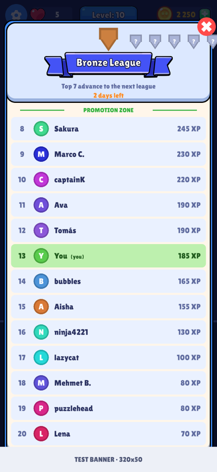
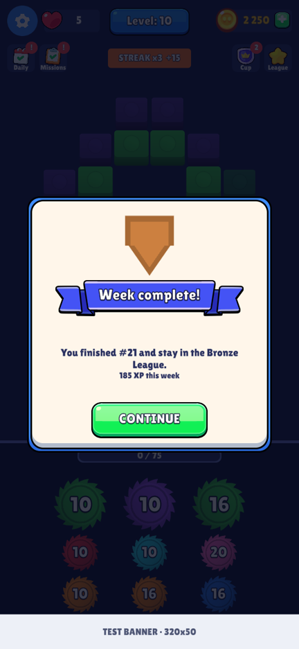
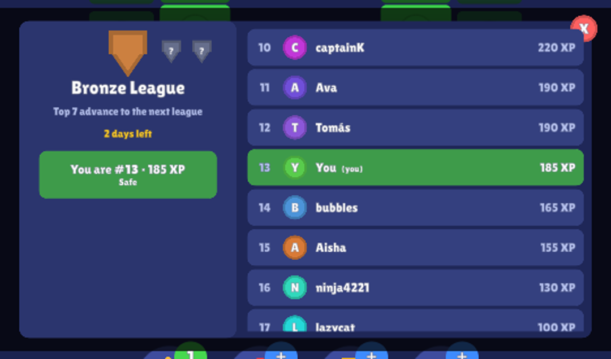
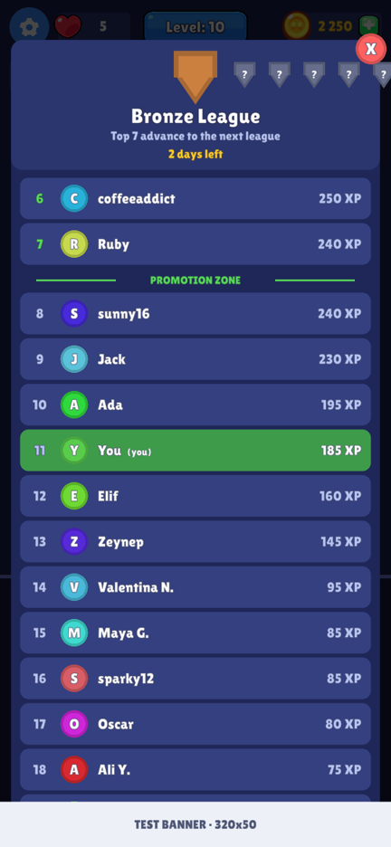
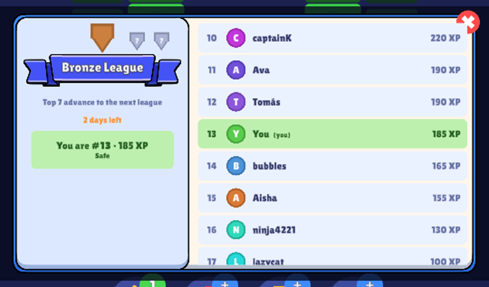

# Aqua League — complete guide

A Duolingo-style **weekly league leaderboard** for any Unity game. Players are placed in groups of 30,
earn XP during the week, and when the week ends the **top 7 move up** a league and the **bottom 5 move down**.

It works in three modes you can switch with one line:

| Mode | Opponents | Server |
|---|---|---|
| **Simulated** | 29 simulated players | none — works offline |
| **Online** | real players | Firebase (free plan) |
| **Hybrid** | real players, empty seats filled with simulated players | Firebase |

 

---

## Contents
1. [Features](#1-features)
2. [Install](#2-install)
3. [Quick start](#3-quick-start)
4. [How the league works](#4-how-the-league-works)
5. [Modes: Simulated, Online, Hybrid](#5-modes-simulated-online-hybrid)
6. [Portrait and landscape](#6-portrait-and-landscape)
7. [Matching your game's look (theming)](#7-matching-your-games-look-theming)
8. [Integrating it into your game](#8-integrating-it-into-your-game)
9. [Going online with Firebase — step by step](#9-going-online-with-firebase--step-by-step)
10. [How the online version works](#10-how-the-online-version-works)
11. [Costs on Firebase's free plan](#11-costs-on-firebases-free-plan)
12. [Security, cheating and fairness](#12-security-cheating-and-fairness)
13. [Configuration reference](#13-configuration-reference)
14. [Theme reference](#14-theme-reference)
15. [API reference](#15-api-reference)
16. [Adding another backend (PlayFab, your own server)](#16-adding-another-backend-playfab-your-own-server)
17. [Testing](#17-testing)
18. [Troubleshooting](#18-troubleshooting)
19. [Package layout](#19-package-layout)
20. [Updating and uninstalling](#20-updating-and-uninstalling)

---

## 1. Features

- **League structure**: 10 leagues (Bronze → Diamond), groups of 30, promotion and demotion zones, weekly reset —
  every number configurable.
- **Simulated players** with names, avatars and personalities (steady, bursty, weekend, quitter, grinder). Their
  scores grow live through the week and never go down. Deterministic: same group, same players, same scores on every
  launch and every device. They adapt to the player's pace so there is always a race.
- **Real players** on Firebase Firestore with anonymous sign-in (no login screen), groups filled in join order like
  Duolingo, offline tolerance, anti-cheat security rules.
- **Hybrid** mode so groups look full at launch even with few real players.
- **UI**: league badges, countdown, medals for the top 3, promotion/demotion zone lines, highlighted player row with
  auto-scroll, live refresh, end-of-week result popup. **Portrait, landscape and auto** layouts.
- **Theming**: font, colours, and your own UI-kit sprites (panel, rows, ribbon title, close button, buttons).
- **No dependencies** on your game: only uGUI and TextMeshPro. Optional Firebase add-on compiles only when enabled.
- Pluggable **backend interface** for PlayFab or your own server.

---

## 2. Install

**Requirements**: Unity **2021.3 or newer** (built and tested on Unity 6), **uGUI** and **TextMeshPro**.
- Unity 6: TextMeshPro is part of uGUI — nothing to add.
- Unity 2021/2022: install the *TextMeshPro* package.
- **All versions: import TMP Essential Resources once per project** (*Window → TextMeshPro → Import TMP Essential
  Resources*) — most projects already have them. Without them TextMeshPro has no default font, and the league logs
  "TextMeshPro Essential Resources are missing" instead of opening (unless you pass your own `LeagueTheme.font`).

Pick one way:

### A. Package Manager (recommended — easy updates)
*Window → Package Manager → **+** → **Add package from git URL…*** and paste:
```
https://github.com/moaazafzal/leaderboard.git#v1.0.1
```
(`#v1.0.1` pins the version; leave it off to always get the latest `main`.)

The repository is **private**: Unity downloads it with your computer's git, so that machine must be signed in to
GitHub (`gh auth login` + `gh auth setup-git`, or a git credential manager), or use the SSH form
`git@github.com:moaazafzal/leaderboard.git#v1.0.1` if you use SSH keys.

### B. Edit `Packages/manifest.json`
```json
"dependencies": {
  "com.aquagames.league": "https://github.com/moaazafzal/leaderboard.git#v1.0.1",
  ...
}
```

### C. `.unitypackage`
Download `AquaLeague-1.0.0.unitypackage` from the repository's **Releases** page and double-click it
(it installs into `Assets/AquaLeague`).

### D. Copy the folder
Copy the repository folder into your project's `Packages/` folder (an "embedded package" you can edit) —
or into `Assets/`.

> Install it **only once** per project. If you previously copied the league into `Assets/…`, delete that copy
> before adding the package, otherwise Unity reports two `AquaGames.League` assemblies.

**Try the sample**: *Package Manager → Aqua League → Samples → League Demo → Import*, then add the **LeagueDemo**
component to an empty GameObject in any scene and press Play.

---

## 3. Quick start

```csharp
using AquaGames.League;
using UnityEngine;

public class MyGame : MonoBehaviour
{
    public RectTransform popupLayer;          // a full-screen RectTransform under your Canvas
    static LeagueService league;              // keep ONE instance for the whole app

    void Awake()
    {
        league ??= new LeagueService(LeagueConfig.Default());   // Simulated mode — no server needed
        league.PlayerName = "Alex";
    }

    public void OnLevelWon()     => league.AddXP(15);          // give XP for your core action
    public void OnLeagueButton() => LeagueView.Open(popupLayer, league);

    void Start() => ShowLeagueResultIfAny();

    void ShowLeagueResultIfAny()
    {
        var r = league.PendingResult;                           // a finished week, shown once
        if (r == null) return;
        int coins = r.rank == 1 ? 500 : r.rank <= 3 ? 200 : r.promoted ? 150 : 0;
        LeagueView.ShowResult(popupLayer, r, league, null,
            onClosed: () => MyWallet.Add(coins),
            rewardText: coins > 0 ? $"Reward: {coins} coins" : null);
    }

    void OnApplicationPause(bool paused) { if (paused) league.Flush(); }
}
```

That's the complete offline version. Section 9 turns on real players.

**Canvas setup**: a Screen Space Overlay canvas with a **Canvas Scaler** (Scale With Screen Size) at
**1080×1920, match width** for portrait games or **1920×1080, match height** for landscape games. Pass any
full-screen `RectTransform` under it as `popupLayer`.

---

## 4. How the league works

| Rule | Default | Setting |
|---|---|---|
| Leagues | Bronze, Silver, Gold, Sapphire, Ruby, Emerald, Amethyst, Pearl, Obsidian, Diamond | `tiers`, `tierColors` |
| Group size | 30 players (incl. the player) | `groupSize` |
| Promotion | top 7 move up (not from the top league) | `promoteCount` |
| Demotion | bottom 5 move down (not from the bottom league) | `demoteCount` |
| Week | 7 days, starts Monday 00:00 UTC | `weekLengthDays`, `weekStartsOn` |
| Joining | with the first XP of the week (like Duolingo) | — |
| Ties | the player wins ties | — |

**Week rollover.** The first time the league runs after a week ends (launch, `AddXP`, opening the board) it scores
the finished week: final rank → promoted / stayed / demoted → `PendingResult` is set and the `WeekFinished` event
fires. Weeks with no XP are skipped (the player keeps their league). If the app was closed for several weeks, the
last played week is scored.

**Simulated players** have a name, an avatar and a personality — *steady*, *bursty* (nothing some days, a lot on
others), *weekend* players, *quitters* (play a day then stop) and *grinders*. Their XP grows during their daily
"playing hours" and **never goes down**. They are deterministic: the same group always contains the same people
with the same score at the same moment, on every launch and on every device. They scale towards the player's own pace
from previous weeks (`rubberBand`), so the player usually has close rivals.

---

## 5. Modes: Simulated, Online, Hybrid

| Mode | When to use |
|---|---|
| **Simulated** | offline games, prototypes, before you set up a server |
| **Online** | you have enough daily players to fill groups of 30 |
| **Hybrid** | **launch** — groups always look full while your player base grows |

```csharp
var cfg = LeagueConfig.Default();
cfg.mode = LeagueMode.Hybrid;           // Simulated / Online / Hybrid
var league = new LeagueService(cfg);

league.SetMode(LeagueMode.Simulated);  // switch at runtime, e.g. from a remote-config flag
```

- Switching keeps the player's league, weekly XP and history.
- If the online backend isn't installed or can't start, `fallbackToSimulated = true` (default) keeps the league
  running in Simulated mode and logs a warning. `league.ActiveMode` tells you what is actually running and
  `league.Status` shows Simulated / Connecting / Online / Offline.
- In Hybrid, simulated players are seeded by the **group id**, so every member of a group sees the same ones.
- **Transparency**: `showSimulatedNote = true` shows "Practice league · some players are simulated" under the
  list whenever simulated players are present. Some stores and players object to bots presented as real people —
  check the rules for your markets and audience.

---

## 6. Portrait and landscape

`LeagueConfig.orientation`:
- **Auto** (default) — landscape layout when the parent is wider than tall, portrait otherwise.
- **Portrait** — header on top (badges, league name, "Top 7 advance…", countdown), ranked list below.
- **Landscape** — header column on the left (badges, name, countdown and a "You are #13 · 185 XP · Safe" card),
  list on the right.



Sizes are designed for the canvas setups in section 3. Using another reference resolution? Set `LeagueTheme.scale`.

---

## 7. Matching your game's look (theming)

Without a theme you get the built-in dark look. To make the league look like the rest of your game, give it your
font, colours and UI-kit sprites:

```csharp
var theme = new LeagueTheme
{
    font = myFont,                    // TMP_FontAsset
    fontMaterial = myPlainMaterial,   // body text
    titleMaterial = myHeavyMaterial,  // titles and buttons (e.g. thick outline)

    panelSprite = kit["Popup_Bg"],    panel = cream,   panelBorder = blue, borderWidth = 12,
    rowSprite   = kit["Card_Round"],  header = lightBlue, row = paleBlue, playerRow = paleGreen,
    ribbonSprite = kit["Title_Ribbon"],                // banner behind the league name and result headline
    closeSprite = kit["Circle_Button"], closeIcon = kit["Icon_Close"], closeColor = red,
    buttonSprite = kit["Button_Green"], button = Color.white,

    text = darkNavy, rowText = darkNavy, rowTextDim = slate, playerRowText = darkGreen,
    timerColor = orange, promotion = green, demotion = red,
};
LeagueView.Open(popupLayer, league, theme);
LeagueView.ShowResult(popupLayer, result, league, theme, onClosed, rewardText);
```

| Default theme | Themed to a game (Layer Lab kit) |
|---|---|
|  |  |



Tips: 9-sliced sprites work best for panel/row/button; keep row text dark on light rows and light on dark rows;
use the same theme object for the board and the result popup.

---

## 8. Integrating it into your game

**XP design.** Give XP for the core action (win a level, finish a lesson, a run…): about 10 per success plus
small bonuses (no revive, streak, perfect). One session ≈ 10–30 XP. Then set `baseXpPerDay` to roughly
**3–4 × one session**: an average player lands mid-table and a daily player climbs about one league every 1–2 weeks.

**Rewards.** The package never grants rewards itself — you decide what a rank is worth, either in the
`onClosed` callback of `ShowResult` (as in the quick start) or in `league.WeekFinished`.

**Where to show things.**
- Put a *League* button on your main screen or HUD (`league.TierName`, `league.PlayerRank`,
  `LeagueView.Countdown(league.TimeLeft)` are handy for its label).
- Call your "show result" code at a calm moment: app start or returning to the menu. It shows once.
- Unlock the league after the tutorial (e.g. level 4) so beginners aren't overwhelmed.

**Must do**: one `LeagueService` for the whole app, and `league.Flush()` in `OnApplicationPause(true)`.

**Player names.** `league.PlayerName = "…"` (shown on the board, uploaded online). If players type their own names,
filter profanity before setting it. Default: "You".

---

## 9. Going online with Firebase — step by step

Firebase's **Spark (free) plan** includes Firestore and Anonymous Authentication — no credit card needed.

### 9.1 Create the Firebase project
1. <https://console.firebase.google.com> → **Add project** → name → (Analytics optional) → **Create**.
2. **Add app → Android**: enter your Unity *Player Settings → Package Name* → download **`google-services.json`**.
   **Add app → iOS** (if you ship iOS): bundle id → download **`GoogleService-Info.plist`**.
3. Put both files anywhere under your project's `Assets/` folder (e.g. `Assets/Firebase/`).

### 9.2 Turn on the services
1. **Build → Authentication → Get started → Sign-in method → Anonymous → Enable**
   (players are signed in silently — no login screen).
2. **Build → Firestore Database → Create database** → *Production mode* → a region near your players.
3. **Firestore → Rules** → paste the contents of **`Firebase/firestore.rules`** from this package
   (in Unity: `Packages/Aqua League/Firebase/firestore.rules`) → **Publish**.
   If you change `collectionPrefix`, `groupSize` or `maxXpPerUpload`, edit the same names/numbers in the rules.

### 9.3 Add the Firebase SDK to Unity
1. Download the **Firebase Unity SDK** (<https://firebase.google.com/download/unity>) and import
   **`FirebaseAuth.unitypackage`** and **`FirebaseFirestore.unitypackage`** (they include FirebaseApp and the
   External Dependency Manager).
2. Android: *Assets → External Dependency Manager → Android Resolver → Force Resolve*.
   iOS: CocoaPods are resolved when you build.

### 9.4 Switch the league online
1. **Project Settings → Player → Other Settings → Scripting Define Symbols**: add **`LEAGUE_FIREBASE`**
   for Android and iOS (and Standalone to test in the Editor). This compiles the Firebase backend.
2. In code: `cfg.mode = LeagueMode.Hybrid;` (recommended) or `LeagueMode.Online`.
3. Press Play. There should be no "[League] backend 'firebase' is not installed" warning and `league.Status`
   becomes **Online**. After the first `AddXP`, the data appears in the Firestore console (section 10).

**Test with real people**: two devices (or Editor + device) earning XP in the same week and league usually land in
the same group — groups fill in the order players become active.

### 9.5 Recommended
- **App Check** (Firebase console) so only your real app can use your database.
- Offline persistence is on by default in the Firebase Unity SDK — XP earned offline is uploaded later.

---

## 10. How the online version works

**Data** (Firestore, default prefix `league`):
```
league_counters/{week}_{tier}                        { group: 3, count: 17 }       group currently filling up
league_groups/{week}_{tier}_{group}/members/{uid}    { name, xp, color, updatedAt }
league_users/{uid}                                   { name, tier, week, groupId }  player profile
```
- `week` = week number (weeks since 2024-01-01, aligned to `weekStartsOn`); `tier` = 0 (Bronze) … 9 (Diamond).
- `uid` = the Firebase anonymous user id (kept across launches on that device).

**Joining**: on the player's first XP of the week, a Firestore **transaction** reads the counter for that week and
league; if the current group already has 30 members it opens the next one; then it adds the player with 0 XP.

**XP**: `AddXP` updates the local total immediately (instant feedback) and uploads it at most every
`uploadDebounceSeconds` (20 s), plus when the board opens and when the app pauses. One upload may add at most
`maxXpPerUpload` (500) — bigger gains are sent in several steps.

**Standings**: when the board opens, the group's members are fetched (one query, ≤ 30 documents) and refreshed every
`refreshSeconds` (60 s) while it stays open. Hybrid adds simulated players for empty seats.

**End of week**: on the first run after the week ends, the client fetches its group's final member list, computes
its rank and moves up or down. If the device is offline, the board shows "Calculating last week's results…" and it
retries automatically.

**Offline**: the board shows the last fetched standings ("Offline · showing last known standings"); XP earned offline
is kept and uploaded later.

---

## 11. Costs on Firebase's free plan

Spark plan daily quotas: **50,000 reads**, **20,000 writes**, 1 GiB storage. Per active player per day, with defaults:

| Action | Reads | Writes |
|---|---|---|
| Join a group (once a week) | 1 | 3 |
| XP uploads (debounced, ~10 sessions) | 0 | ~10 |
| Opening the board ~4× (≤ 30 documents each + refreshes) | ~150 | 0 |
| **Total** | **~150** | **~10** |

→ about **300 daily active players** on the free plan. To stretch it: raise `refreshSeconds` (e.g. 180) or open
the board less often. Beyond that, the **Blaze** pay-as-you-go plan costs about **US$0.06 per 100,000 reads** — a few
dollars a month for thousands of players.

---

## 12. Security, cheating and fairness

- The supplied **security rules** allow each player to write **only their own row**; XP can **only go up**, by
  **at most 500 per write**; names are limited to 24 characters; group counters can only advance one step at a time.
- The client computes its own promotion, so a modified app could lie about its league. For a casual weekly league
  that's usually acceptable. For stricter play, close the week in a Cloud Function (Blaze plan) or use a
  server-authoritative backend (section 16).
- Turn on **App Check** to block scripts that aren't your app.
- Filter profanity in player-typed names.

---

## 13. Configuration reference

`LeagueConfig.Default()` gives these values:

| Field | Default | Meaning |
|---|---|---|
| `mode` | Simulated | Simulated / Online / Hybrid |
| `onlineBackend` | "firebase" | id of the backend used by Online/Hybrid |
| `fallbackToSimulated` | true | keep working offline if the backend is missing |
| `tiers` / `tierColors` | 10 leagues | names and badge colours, lowest first |
| `groupSize` | 30 | players per group incl. the player |
| `promoteCount` / `demoteCount` | 7 / 5 | zone sizes |
| `weekLengthDays` / `weekStartsOn` | 7 / Monday | week length and start day (UTC) |
| `baseXpPerDay` | 60 | simulated activity in the first league |
| `tierXpGrowth` | 1.22 | activity multiplier per league up |
| `rubberBand` | 0.55 | 0–1: how much simulated players follow the player's pace |
| `inactiveShare` | 0.12 | share of simulated players that quit early |
| `xpStep` | 5 | rounding of simulated XP |
| `collectionPrefix` | "league" | Firestore collection prefix (share one project between games) |
| `refreshSeconds` | 60 | online standings refresh while the board is open |
| `uploadDebounceSeconds` | 20 | minimum time between XP uploads |
| `maxXpPerUpload` | 500 | per-write XP cap (must match the rules) |
| `leagueWord` | "League" | shown as "Gold League" |
| `orientation` | Auto | Auto / Portrait / Landscape |
| `showSimulatedNote` / `simulatedNote` | false / text | note shown when simulated players are present |

---

## 14. Theme reference

`new LeagueTheme { … }` — every field is optional:

| Field | Meaning |
|---|---|
| `font`, `fontMaterial` | TMP font asset and body-text material |
| `titleMaterial` | material for titles and buttons |
| `dim` | full-screen dim behind the board |
| `panel`, `panelSprite` | main panel colour and sprite |
| `panelBorder`, `borderWidth` | outline behind the panel (alpha 0 = none) |
| `header` | header background (top band in portrait, left column in landscape) |
| `row`, `playerRow`, `rowSprite` | list rows and the player's row |
| `ribbonSprite`, `ribbonText` | banner behind the league name and the result headline |
| `closeSprite`, `closeIcon`, `closeColor` | close button (generated circle + "X" if null) |
| `button`, `buttonSprite`, `buttonText` | result popup button |
| `text`, `textDim`, `headerText` | general text colours |
| `rowText`, `rowTextDim`, `playerRowText` | names and XP on rows, text on the player row |
| `timerColor`, `promotion`, `demotion`, `medals[3]`, `lockedBadge` | accents |
| `scale` | multiply all sizes |

---

## 15. API reference

**`LeagueService`**
| Member | Description |
|---|---|
| `new LeagueService(LeagueConfig, ILeagueStorage = PlayerPrefs, Func<DateTime> clock = UtcNow)` | create once per app |
| `AddXP(int)` | player earned XP (joins the week's group on the first XP) |
| `Flush()` | upload pending XP now (call on app pause) |
| `Refresh(bool force)` | refresh online standings (the board does this itself) |
| `SetMode(LeagueMode)` / `ActiveMode` | switch modes / what's actually running |
| `Status` / `StatusText` | Simulated · Connecting · Online · Offline, and a user-facing line |
| `Standings()` | the 30 entries sorted, each with `rank`, `name`, `xp`, `isPlayer`, `isSimulated` |
| `PlayerRank`, `XP`, `Joined`, `Tier`, `TierName`, `TimeLeft` | current state |
| `ZoneOf(rank, tier)` | Promotion / Safe / Demotion |
| `PendingResult` / `ClearPendingResult()` | last finished week (`WeekResult`), shown once |
| `ResultPending` | a finished week is still being scored (online, device offline) |
| `PlayerName` | display name |
| `Changed` | event: XP, standings or week changed |
| `WeekFinished` | event: a week was scored (`rank`, `tierBefore`, `tierAfter`, `promoted`, `demoted`, `xp`) |
| `DebugTimeOffset` | fast-forward the clock (testing) |

**`LeagueView`**
| Member | Description |
|---|---|
| `LeagueView.Open(RectTransform parent, LeagueService, LeagueTheme = null, Action onClose = null)` | the board, full-size inside `parent` |
| `LeagueView.ShowResult(parent, WeekResult, LeagueService, LeagueTheme, Action onClosed, string rewardText)` | end-of-week popup; clears the pending result on Continue |
| `LeagueView.Countdown(TimeSpan)` | "2 days left" / "5h 12m left" |

**Storage** — `ILeagueStorage` (`Load` / `Save` a `LeagueSave`). Included: `PlayerPrefsLeagueStorage(key)`
(default key `aquagames_league_v1`) and `MemoryLeagueStorage` (tests). Implement it to keep the league inside your own
save file or cloud save.

---

## 16. Adding another backend (PlayFab, your own server)

Implement `ILeagueBackend` and register it:

```csharp
using System;
using System.Collections.Generic;
using AquaGames.League;
using UnityEngine;

public class MyServerBackend : ILeagueBackend
{
    [RuntimeInitializeOnLoadMethod(RuntimeInitializeLoadType.SubsystemRegistration)]
    static void Register() => LeagueBackends.Register("myserver", _ => new MyServerBackend());

    public LeagueStatus Status { get; private set; } = LeagueStatus.Connecting;
    public string StatusText => Status == LeagueStatus.Offline ? "Offline" : "";
    public event Action Updated;

    public void Initialize(LeagueService svc) { /* sign in; Status = Online; Updated?.Invoke(); */ }
    public void Join(int week, int tier) { /* ask the server for a group, store svc.Save.groupId */ }
    public void ReportXp(int week, int xp, bool force) { /* upload (debounce unless force) */ }
    public List<LeagueEntry> Opponents(int week, int tier, DateTime at) { /* cached group members, excluding the player */ return new List<LeagueEntry>(); }
    public void FinalOpponents(int week, int tier, string groupId, Action<List<LeagueEntry>> done) { /* final list, or done(null) to retry later */ }
    public void Refresh(bool force) { /* re-fetch if older than refreshSeconds, then Updated?.Invoke() */ }
}
```
Then `cfg.onlineBackend = "myserver";`. Weeks, promotion, UI and Hybrid fill-ins (`BotFactory`) keep working.
`Firebase/FirestoreBackend.cs` is a complete reference implementation.

**PlayFab**: the free tier works too, but grouping players into cohorts of 30 needs server logic (CloudScript /
Azure Functions) because PlayFab has no client-side transactions — which is why Firebase is the default.

---

## 17. Testing

- **League Demo sample**: buttons for XP, skip a day, finish the week, switch modes.
- **Fast-forward**: `league.DebugTimeOffset = TimeSpan.FromDays(7);` then `league.Sync();` scores the week.
- **Online**: watch `league_groups/…/members` in the Firestore console while adding XP on two devices.
- **Reset**: delete the PlayerPrefs key (`aquagames_league_v1`, or the key you passed to `PlayerPrefsLeagueStorage`).

---

## 18. Troubleshooting

| Symptom | Fix |
|---|---|
| "[League] backend 'firebase' is not installed" | add `LEAGUE_FIREBASE` to Scripting Define Symbols; import FirebaseAuth + FirebaseFirestore |
| Status stays **Connecting** | `google-services.json` / `GoogleService-Info.plist` missing, or Android resolver not run |
| **Offline** with "PERMISSION_DENIED" in the log | rules not published, or prefix/limits in the rules don't match `LeagueConfig` |
| "sign-in failed" | enable **Anonymous** sign-in in Firebase Authentication |
| Everyone lands in a separate group | normal with few players online — use **Hybrid** |
| Two `AquaGames.League` assemblies | the league is installed twice (package + copied folder) — remove one |
| Package won't download (private repo) | sign in to GitHub on that machine (`gh auth setup-git`) or use the SSH URL |
| "TextMeshPro Essential Resources are missing" | *Window → TextMeshPro → Import TMP Essential Resources* |
| Squares instead of letters | the TMP font lacks those glyphs — set `LeagueTheme.font` |
| Board too small or too big | set `LeagueTheme.scale` or use the canvas setup in section 3 |

---

## 19. Package layout

```
package.json                     package manifest (com.aquagames.league)
README.md                        overview
CHANGELOG.md
Documentation~/LEADERBOARD.md    this guide (+ images/)
Runtime/
  AquaGames.League.asmdef        core assembly (uGUI + TextMeshPro only)
  Core/
    LeagueService.cs             facade: weeks, XP, leagues, results, mode switching
    LeagueConfig.cs              all settings
    LeagueModels.cs              entries, results, save data
    ILeagueBackend.cs            backend interface + registry
    SimulatedBackend.cs          offline opponents
    BotFactory.cs                deterministic simulated players
    NamePool.cs                  names for simulated players (edit freely)
    LeagueStorage.cs             PlayerPrefs / memory storage
  UI/
    LeagueView.cs                board + result popup (portrait & landscape)
    LeagueTheme.cs               colours, fonts, sprites, generated shapes
Firebase/                        compiled only with LEAGUE_FIREBASE
  AquaGames.League.Firebase.asmdef
  FirestoreBackend.cs            Firestore + Anonymous Auth backend
  firestore.rules                security rules to publish
Samples~/Demo/LeagueDemo.cs      importable sample
```

---

## 20. Updating and uninstalling

- **Update**: change the tag in the git URL (`#v1.0.1` → `#v1.1.0`) in Package Manager or `manifest.json`.
  Player data (PlayerPrefs / Firestore) is kept across versions.
- **Uninstall**: remove the package in Package Manager (or the line in `manifest.json`), and delete your
  `LeagueService` usages. Player data stays in PlayerPrefs under `aquagames_league_v1` until you delete it.
