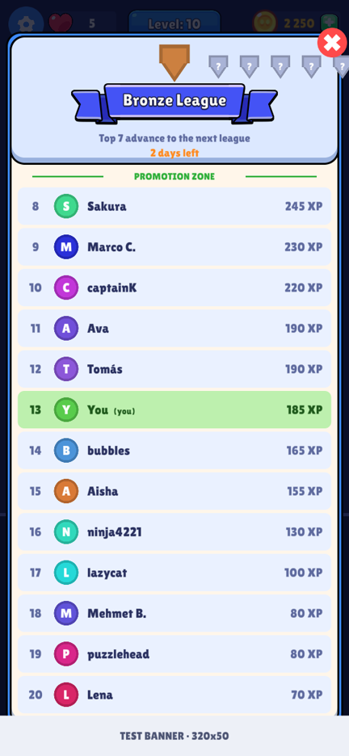
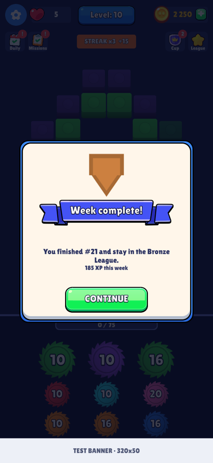
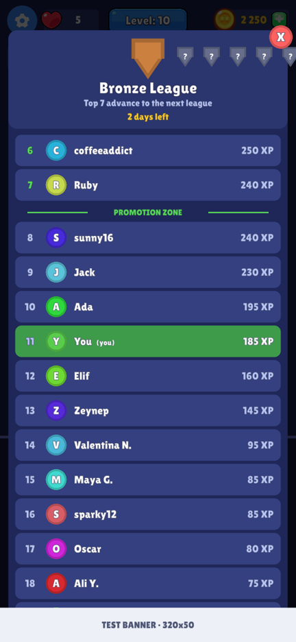
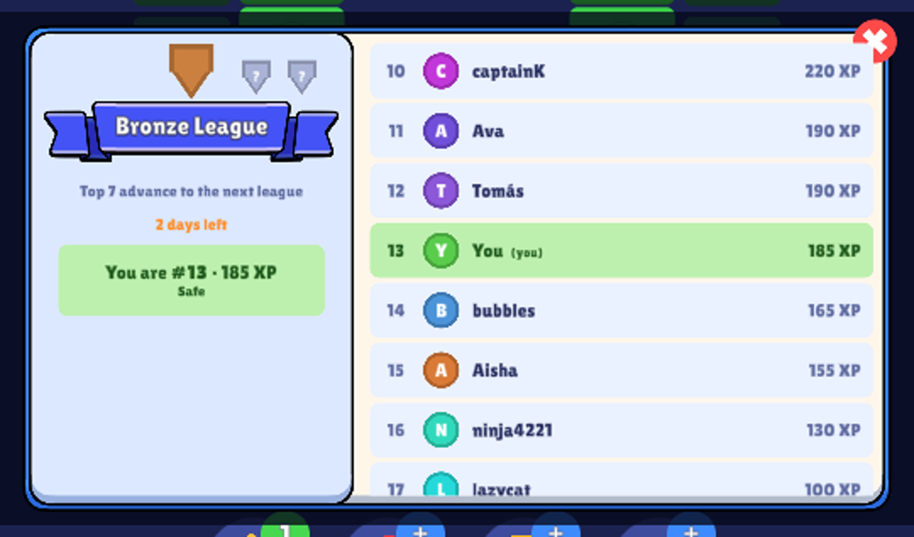

# Aqua League — weekly leaderboard for Unity

A **Duolingo-style weekly league** you can drop into any Unity game: groups of 30, 10 leagues from Bronze to Diamond,
the **top 7 move up** and the **bottom 5 move down** every week.

- **Simulated** — works offline with realistic simulated players (no server).
- **Online** — real players on **Firebase** (free plan).
- **Hybrid** — real players, with empty seats filled by simulated ones (ideal at launch).
- Switch between them with **one line**, portrait or landscape, themed to match your game.

| Portrait (themed) | End of week | Default theme |
|---|---|---|
|  |  |  |



## Install
Unity **2021.3+** (built on Unity 6), uGUI + TextMeshPro (with *TMP Essential Resources* imported —
*Window → TextMeshPro → Import TMP Essential Resources*).

**Package Manager → + → Add package from git URL:**
```
https://github.com/moaazafzal/leaderboard.git#v1.0.1
```
Private repo: the machine needs GitHub access for git (`gh auth setup-git`), or use
`git@github.com:moaazafzal/leaderboard.git#v1.0.1`. A `.unitypackage` is also attached to each
[release](../../releases).

## Use
```csharp
using AquaGames.League;

var league = new LeagueService(LeagueConfig.Default());   // one per app — Simulated by default
league.AddXP(15);                                          // whenever the player earns XP
LeagueView.Open(popupLayer, league);                       // show the board

var r = league.PendingResult;                              // end of week (show once, give rewards)
if (r != null) LeagueView.ShowResult(popupLayer, r, league, null, () => GiveReward(r.rank));

league.SetMode(LeagueMode.Hybrid);                         // fake ↔ real at any time
void OnApplicationPause(bool p) { if (p) league.Flush(); }
```
Try it first: **Package Manager → Aqua League → Samples → League Demo → Import**, add the `LeagueDemo`
component to an empty GameObject, press Play.

## Documentation
**[Complete guide → Documentation~/LEADERBOARD.md](Documentation~/LEADERBOARD.md)**

Install options · how the league works · modes · portrait/landscape · theming to your game · integration
(XP design, rewards) · Firebase setup step by step · data model · free-plan costs · security & anti-cheat ·
full config/theme/API reference · adding PlayFab or your own server · testing · troubleshooting.

## Folder overview
| Path | What |
|---|---|
| `Runtime/Core` | league logic: `LeagueService`, config, simulated players, backend interface |
| `Runtime/UI` | `LeagueView` (board + result popup), `LeagueTheme` |
| `Firebase` | online backend (compiled only with the `LEAGUE_FIREBASE` define) + `firestore.rules` |
| `Samples~/Demo` | `LeagueDemo` test component |
| `Documentation~` | full guide and screenshots |
